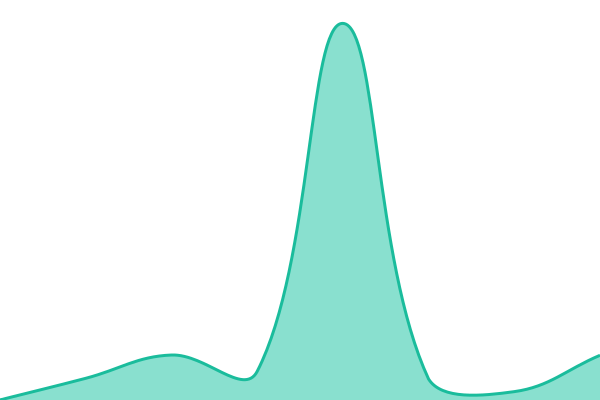
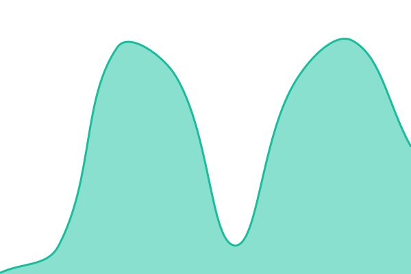
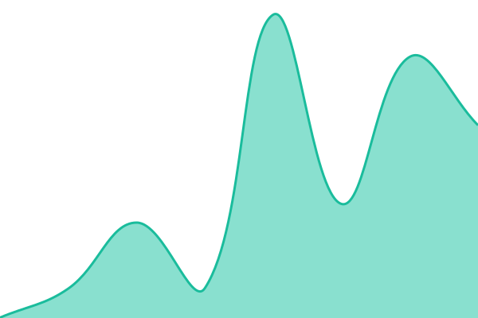

# [📈 Live Status](https://rapidcow.github.io/upptime): <!--live status--> **🟧 Partial outage**

This repository contains the open-source uptime monitor and status page for [rapidcow](https://foss.rapidcow.org/), powered by [Upptime](https://github.com/upptime/upptime).

With [Upptime](https://upptime.js.org), you can get your own unlimited and free uptime monitor and status page, powered entirely by a GitHub repository. We use [Issues](https://github.com/rapidcow/upptime/issues) as incident reports, [Actions](https://github.com/rapidcow/upptime/actions) as uptime monitors, and [Pages](https://rapidcow.github.io/upptime) for the status page.

<!--start: status pages-->
<!-- This summary is generated by Upptime (https://github.com/upptime/upptime) -->
<!-- Do not edit this manually, your changes will be overwritten -->
<!-- prettier-ignore -->
| URL | Status | History | Response Time | Uptime |
| --- | ------ | ------- | ------------- | ------ |
|  [www](https://www.rapidcow.org/) | 🟩 Up | [www-rapidcow-org.yml](https://github.com/rapidcow/upptime/commits/HEAD/history/www-rapidcow-org.yml) | 

 802ms
     
 | 

<a href="https://rapidcow.github.io/upptime/history/www-rapidcow-org">100.00%</a>
    

|  [www-auth](https://www-auth.rapidcow.org/) | 🟥 Down | [www-auth-rapidcow-org.yml](https://github.com/rapidcow/upptime/commits/HEAD/history/www-auth-rapidcow-org.yml) | 

 1144ms
     
 | 

<a href="https://rapidcow.github.io/upptime/history/www-auth-rapidcow-org">53.38%</a>
    

|  [status](https://status.rapidcow.org/) | 🟩 Up | [status-rapidcow-org.yml](https://github.com/rapidcow/upptime/commits/HEAD/history/status-rapidcow-org.yml) | 

 891ms
     
 | 

<a href="https://rapidcow.github.io/upptime/history/status-rapidcow-org">100.00%</a>
    

|  [FOSS](https://foss.rapidcow.org/) | 🟩 Up | [foss-rapidcow-org.yml](https://github.com/rapidcow/upptime/commits/HEAD/history/foss-rapidcow-org.yml) | 

 960ms
     
 | 

<a href="https://rapidcow.github.io/upptime/history/foss-rapidcow-org">100.00%</a>
    

|  [ftp](https://ftp.rapidcow.org/pub/lib/perl5/List-Search-0.4.tar.gz) | 🟥 Down | [ftp-rapidcow-org.yml](https://github.com/rapidcow/upptime/commits/HEAD/history/ftp-rapidcow-org.yml) | 

 185ms
     
 | 

<a href="https://rapidcow.github.io/upptime/history/ftp-rapidcow-org">0.00%</a>
    

|  [ns1](https://ns1.rapidcow.net/) | 🟩 Up | [ns1-rapidcow-net.yml](https://github.com/rapidcow/upptime/commits/HEAD/history/ns1-rapidcow-net.yml) | 

 214ms
     
 | 

<a href="https://rapidcow.github.io/upptime/history/ns1-rapidcow-net">100.00%</a>
    

|  [ns2](https://ns2.rapidcow.net/) | 🟩 Up | [ns2-rapidcow-net.yml](https://github.com/rapidcow/upptime/commits/HEAD/history/ns2-rapidcow-net.yml) | 

 82ms
     
 | 

<a href="https://rapidcow.github.io/upptime/history/ns2-rapidcow-net">100.00%</a>
    

|  [school site (blegh)](https://www.endfindme.com/) | 🟩 Up | [school-site.yml](https://github.com/rapidcow/upptime/commits/HEAD/history/school-site.yml) | 

 240ms
     
 | 

<a href="https://rapidcow.github.io/upptime/history/school-site">100.00%</a>
    

|  [CS school site](https://pages.cs.wisc.edu/~emeng/) | 🟩 Up | [cs-school-site.yml](https://github.com/rapidcow/upptime/commits/HEAD/history/cs-school-site.yml) | 

 483ms
     
 | 

<a href="https://rapidcow.github.io/upptime/history/cs-school-site">100.00%</a>
    

|  [neocities](https://rapidcow.neocities.org/) | 🟩 Up | [neocities.yml](https://github.com/rapidcow/upptime/commits/HEAD/history/neocities.yml) | 

 694ms
     
 | 

<a href="https://rapidcow.github.io/upptime/history/neocities">100.00%</a>
    

<!--end: status pages-->

[**Visit our status website →**](https://rapidcow.github.io/upptime)

## 📄 License

- Powered by: [Upptime](https://github.com/upptime/upptime)
- Code: [MIT](./LICENSE) © [Anand Chowdhary](https://anandchowdhary.com)
- Data in the `./history` directory: [Open Database License](https://opendatacommons.org/licenses/odbl/1-0/)
